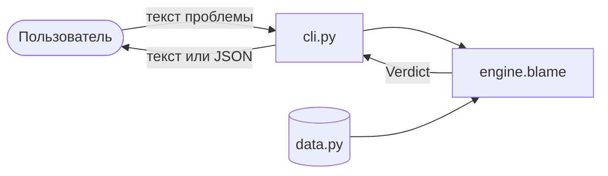
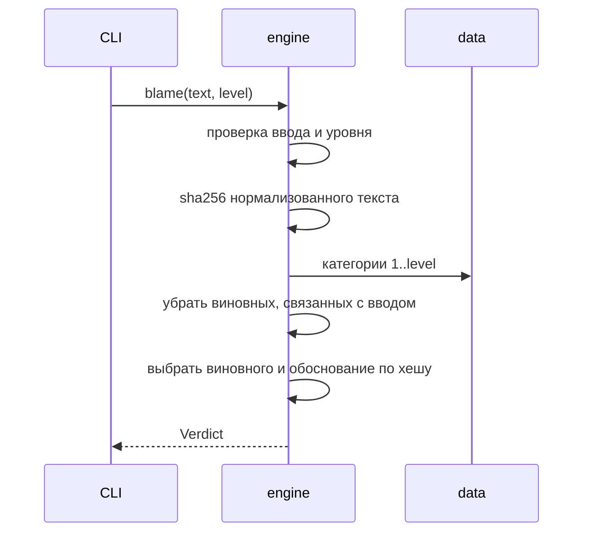
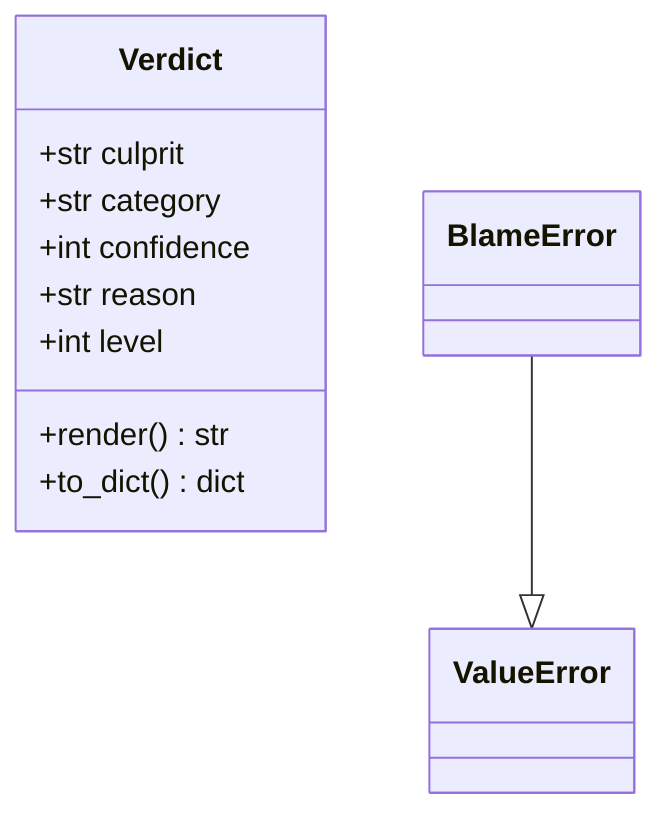

# Архитектура

## Модули

| Модуль | Ответственность |
|---|---|
| `vinovatornik/data.py` | Категории виновников, шаблоны обоснований, запрещённые слова |
| `vinovatornik/engine.py` | Выбор виновника: хеш, фильтр, уверенность |
| `vinovatornik/cli.py` | Разбор аргументов, вывод текста или JSON |
| `tests/` | Автотесты engine и CLI |

## Поток данных

## Что происходит внутри `blame`

## Модель данных

## Решения

- **Без внешних зависимостей** в коде: только стандартная библиотека. Зависит от `pytest` только тестовая часть.
- **Хеш вместо `random`**: результат воспроизводим, а значит тестируем.
- **Данные отдельно от логики**: список виновников расширяется без правки алгоритма.
