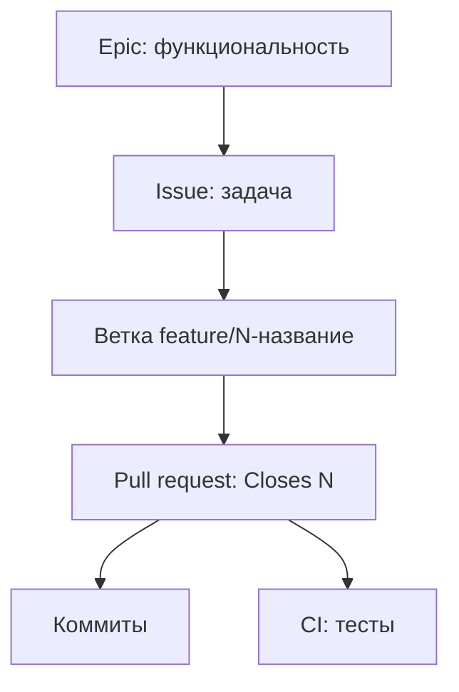
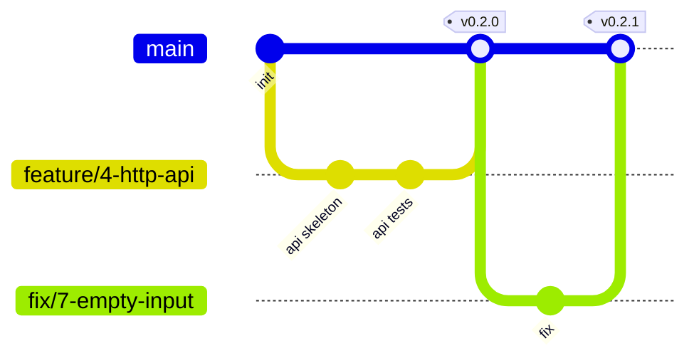

# Процесс разработки

## Выбор жизненного цикла

Проект выполняет один человек, поэтому Scrum с его ритуалами избыточен. Выбран **Kanban** с элементами **XP**:

- маленькие итерации и частая интеграция;
- тесты пишутся вместе с кодом;
- ограничение незавершённой работы (WIP).

| Практика | Как применяется |
|---|---|
| Kanban-доска | GitHub Projects, колонки Backlog → To Do → In Progress → Review → Done |
| WIP-лимит | не больше 2 задач в In Progress |
| Тесты вместе с кодом | PR без тестов не сливается |
| Непрерывная интеграция | CI на каждый push и PR |
| Ревью | самопроверка по чек-листу перед слиянием |

## Артефакты и иерархия

**Задача считается завершённой (Definition of Done), когда:**

1. код слит в `main` через pull request;
2. тесты написаны и CI зелёный;
3. вики и README обновлены, если изменилось поведение;
4. issue закрыт ссылкой `Closes #N` из PR.

## Ветки и слияние

Используется trunk-based подход: `main` всегда рабочий, ветки короткоживущие.

| Префикс ветки | Назначение |
|---|---|
| `feature/N-...` | новая функциональность |
| `fix/N-...` | исправление ошибки |
| `docs/N-...` | документация |
| `chore/N-...` | сборка, CI, зависимости |

Слияние выполняется через pull request способом **Squash and merge**, чтобы в `main` была линейная история.

## Версионирование

Версии по [SemVer](https://semver.org/lang/ru/): `MAJOR.MINOR.PATCH`.

- `PATCH`: исправление без изменения поведения (`0.1.1`)
- `MINOR`: новая совместимая функциональность (`0.2.0`)
- `MAJOR`: несовместимое изменение формата ответа или CLI (`1.0.0`)

Релиз помечается git-тегом `vX.Y.Z`. Версия хранится в `vinovatornik/__init__.py`.

## Версионирование данных

У проекта нет базы данных: данные лежат в `data.py` и версионируются вместе с кодом. Если появится хранилище (например, история запросов), схема будет меняться только через пронумерованные миграции, а номер миграции привязывается к версии релиза.

## Коммиты

Формат: `тип: описание`, например `feat: добавить уровни абсурда`, `fix: пустой ввод`, `docs: страница про алгоритм`, `test: тесты CLI`.
