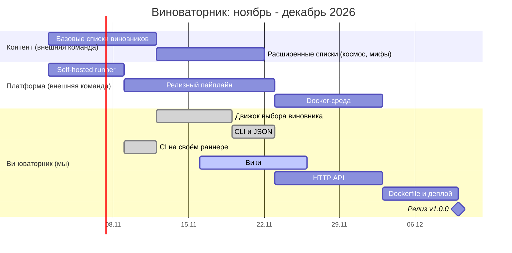

# Роадмап на квартал

Планирование на четыре двухнедельных спринта. Работа зависит от двух соседних команд.

| Команда | Что поставляет |
|---|---|
| **Виноваторник** (мы) | движок, CLI, API, вики |
| **Контент** | списки виновников и шаблоны обоснований |
| **Платформа** | раннеры, релизный пайплайн, контейнерная среда |

## Диаграмма Ганта

## Спринты

| Спринт | Даты | Цель |
|---|---|---|
| 1 | 02.11 - 13.11 | Данные от «Контента», раннер от «Платформы», ядро движка |
| 2 | 16.11 - 27.11 | CLI, CI, вики |
| 3 | 30.11 - 11.12 | HTTP API, расширенные данные |
| 4 | 14.12 - 25.12 | Контейнер, релиз v1.0.0 |

## Зависимости между командами

| Наша задача | Зависит от | Команда | Нужно к | Риск |
|---|---|---|---|---|
| Движок | Базовые списки | Контент | 13.11 | средний |
| CI | Self-hosted runner | Платформа | 09.11 | высокий |
| Dockerfile | Docker-среда | Платформа | 11.12 | средний |

## Как контролируем зависимости

1. **Единая таблица зависимостей** (выше) обновляется на каждом синке.
2. **Scrum of Scrums**: раз в неделю короткий синк представителей команд (15 минут): что сдано, что блокирует, что нужно от других.
3. **Буфер**: между поставкой зависимости и нашим стартом закладывается запас в 2-3 дня.
4. **Ранний контракт**: формат данных от «Контента» согласуется в начале спринта 1, чтобы движок можно было писать на заглушках.
5. **Эскалация**: если зависимость сдвигается больше чем на 3 дня, задача получает метку `blocked` и обсуждается на ближайшем синке.

> [!NOTE]
> Такая схема опирается на идеи Scrum of Scrums и квартального планирования из SAFe (PI Planning), упрощённые под один проект.
