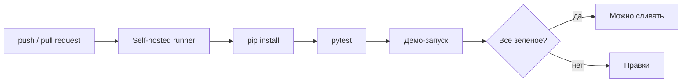

# Тестирование и деплой

## Автоматическое тестирование

Тесты написаны на `pytest` и лежат в `tests/`.

| Файл | Что проверяет |
|---|---|
| `test_engine.py` | детерминированность, инвариант «не связан с вводом», диапазон уверенности, уровни, ошибки |
| `test_cli.py` | вывод, режим JSON, коды возврата |

```bash
python -m pytest -v
```

Ключевой тест проверяет инвариант независимой реализацией сравнения слов, чтобы тест не повторял логику движка. Дополнительно каждый виновник из базы вводится как текст проблемы, и он не должен обвинить самого себя.

## Ручное тестирование

Чек-лист перед релизом:

- [ ] `python -m vinovatornik "в меня врезался грузовик"` печатает четыре строки
- [ ] повторный запуск даёт тот же ответ
- [ ] `--level 1` возвращает только категорию «Быт»
- [ ] `--json` выдаёт корректный JSON
- [ ] пустой ввод даёт понятную ошибку и код возврата 2

## CI/CD



Сборка выполняется на **self-hosted runner**, то есть на собственной машине, а не на серверах GitHub. Конфигурация лежит в `.github/workflows/ci.yml`.

> [!TIP]
> Раннер должен быть запущен (`./run.sh` или `run.cmd`), иначе задачи будут ждать в очереди.

## Выпуск версий

1. Все задачи релиза в колонке Done, CI на `main` зелёный.
2. Поднять версию в `__init__.py`.
3. Создать тег `vX.Y.Z` и GitHub Release с описанием изменений.
4. Развернуть релиз (см. ниже).

## Развёртывание

Релиз разворачивается как пакет Python или как Docker-образ (задача в бэклоге). Откат: установка предыдущего тега.

## Ввод в эксплуатацию

| Сценарий | Порядок действий |
|---|---|
| **Новая система** | развернуть релиз → дымовой тест → открыть доступ пользователям → мониторинг первых дней |
| **Замена существующей системы** | параллельная работа старой и новой → сравнение ответов на тестовых вводах → переключение пользователей → старая система в режиме чтения → вывод из эксплуатации |

План отката при замене: вернуть пользователей на старую систему, пока она не выключена.
